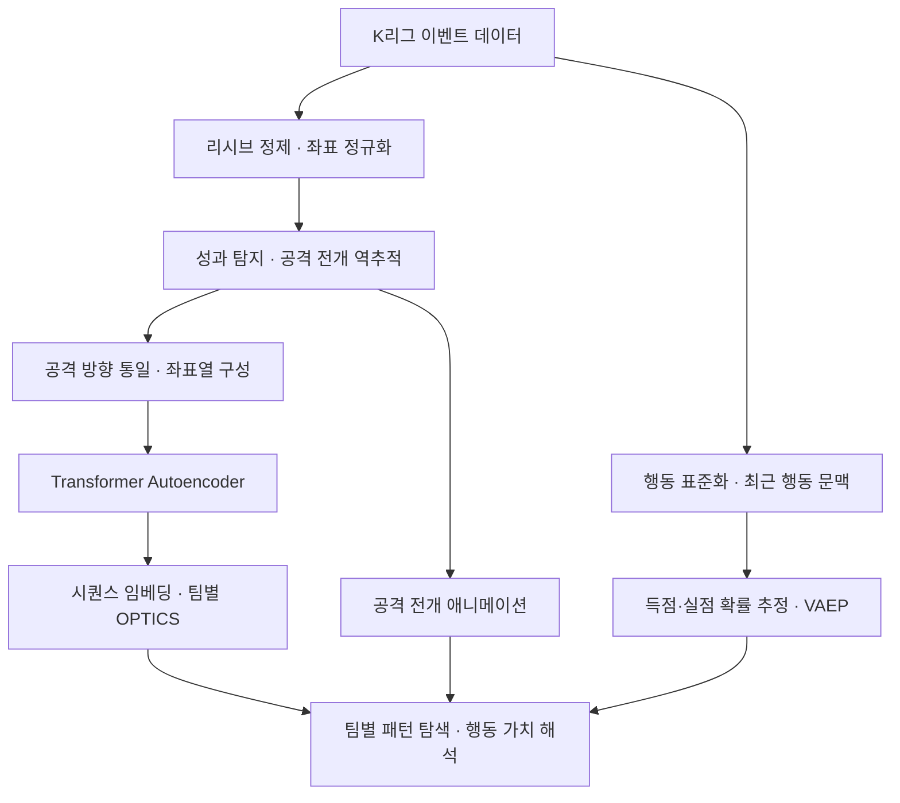

# deTACTer

**K리그 이벤트 데이터에서 반복되는 공격 전개를 발견하고, 각 행동의 가치를 함께 해석하는 전술 분석 프로젝트.**

`Football Analytics` · `Sequence Representation Learning` · `VAEP` · `Team-wise Clustering`

**[웹사이트 바로가기](https://de-tac-ter.vercel.app/)** · **[YouTube에서 보기](https://www.youtube.com/watch?v=cMdmHzS3dso)**

https://github.com/user-attachments/assets/b42762e2-34f7-4d5b-82dd-311a3e4aa445

- **연구 질문** — 슈팅과 박스 진입에 앞선 공격 전개에서 반복되는 공간 패턴을 찾고, 그 과정의 어떤 행동이 득점 기회를 높이거나 실점 위험을 낮췄는지 설명할 수 있는가?
- **접근** — 성과 지점에서 공격 전개를 역추적하고, Transformer Autoencoder로 좌표열을 표현한 뒤 팀별로 군집화. VAEP 행동 가치와 애니메이션을 결합하여 패턴과 개별 행동을 함께 분석.
- **데이터** — K리그 **198경기 · 12개 팀 · 579,306개 이벤트**. 대시보드에서 **205개 공격 시퀀스** 탐색.

## Research problem

슈팅 수나 득점 수는 공격의 결과를 요약할 뿐, 기회를 만들기까지 어떤 경로를 거쳤는지는 보여주지 않는다. 그래서 패스와 운반을 연결한 전개 과정 자체를 분석 단위로 삼았다.

- **반복성과 가치는 다른 축이다** — 자주 나오는 전개라고 해서 가치가 높은 것은 아니어서, 공간적으로 비슷한 공격을 찾는 문제와 각 행동의 가치를 매기는 문제를 따로 다뤘다.
- **시퀀스를 비교 가능하게 만드는 게 먼저다** — 같은 공격도 진영, 기록 방식, 이벤트 경계에 따라 다른 좌표열로 남는다. 표현 학습에 들어가기 전에 방향·연속성·중복·종료 조건부터 정의해야 했다.
- **여기서 말하는 패턴의 범위** — 성과로 이어진 이벤트 좌표열이 반복되는 형태를 가리킨다. 감독의 의도나 선수 전체의 움직임까지 담은 전술 라벨은 아니다.

## Research design

- **성과에서 거꾸로 분석 단위를 잡는다** — 임의의 시간 구간을 자르는 대신, 슈팅이나 상대 박스 내 행동에서 출발해 이전 전개를 역추적해 공격의 도착 지점을 명확히 한다.
- **좌표를 복원하는 방식으로 전개를 학습시킨다** — 전술 유형을 사람이 미리 붙이지 않고, 좌표열을 복원하는 과정에서 행동 사이의 공간 관계가 임베딩에 담기도록 했다. 이 임베딩을 군집화에 그대로 쓴다.
- **패턴은 팀 단위로 찾는다** — 팀마다 스타일이 다르므로 시퀀스를 팀별로 분리해 내부 반복성을 본다. 군집 수는 미리 정하지 않고, 밀도가 낮은 사례는 노이즈로 남겨둔다.
- **패턴과 행동 가치는 따로 계산해서 나중에 합친다** — 임베딩은 패턴의 유사성만, VAEP는 행동의 기여만 설명한다. VAEP를 임베딩 입력에 섞지 않은 이유도 두 분석의 역할을 겹치지 않게 하기 위해서다.

## Method

### 1. 이벤트를 연속된 공격 전개로 정제

원본 이벤트에는 경기·피리어드·시간, 팀·선수, 행동 유형과 결과, 시작·종료 좌표가 있지만, 이벤트 사이의 위치는 연속적으로 기록되지 않는다. 이걸 이어 붙일 수 있는 형태로 정리하는 게 첫 단계다.

- 105 × 68m 경기장 기준으로 범위를 보정하고 좌표를 0–1로 정규화한다. 공격 방향은 시퀀스를 구성한 뒤 공격팀 기준으로 맞춘다.
- 후속 행동과 위치가 겹치는 리시브는 중복 기록이므로 제거하고, 실제로 이동이 있었던 리시브는 운반 행동으로 바꾸거나 인접한 운반 행동에 합친다.
- 정제 후 이전 행동의 종료점과 다음 행동의 시작점 사이 간극을 검사해서, 허용 오차를 넘는 단절은 역추적을 끊는 경계로 쓴다. 안 그러면 서로 이어지지 않은 장면이 하나의 공격으로 묶여버린다.

### 2. 성과 지점에서 공격 시퀀스를 역추적

성과 후보는 슈팅이거나 상대 박스 영역에서 시작하는 유효 행동이다. 태클·인터셉트·클리어링·골키퍼 수비 같은 수비 행동은 후보에서 뺀다. 공격 방향은 경기·피리어드·팀별 골키퍼 평균 위치로 추정하고, 시퀀스 안 양 팀 이벤트에 같은 좌표 변환을 적용해 상대적 위치 관계를 그대로 둔다.

박스 판정은 왼쪽에서 오른쪽으로 공격할 때 x > 0.84, 0.36 < y < 0.635로 정의했다. 이 y 범위는 슈팅 판정에도 그대로 쓰이기 때문에, 실제 박스 전체나 모든 슈팅을 포괄하는 정의는 아니고 분석 편의를 위해 좁혀놓은 것이다.

성과에서 과거로 거슬러 올라가다가 경기·피리어드가 바뀌거나, 이미 다른 시퀀스에 쓰인 행동을 다시 만나거나, 공격팀 좌표가 끊기거나, 세트피스를 만나면 역추적을 멈춘다. 상대팀의 개입 자체는 시퀀스 후보에 포함시킨다. 추출 조건은 목표 공격팀 행동 수 8개, 성과가 아닌 행동 중 순수 패스 최소 3개, 전체 이벤트 최소 5개로 고정했지만, 경계에서 일찍 끊기거나 상대팀 행동이 섞이는 경우가 있어 실제 길이는 조건과 다를 수 있다. 성과 이전의 비성과 행동이 이미 박스 안에서 시작하는 시퀀스는 혼전으로 보고 제외했다 — 박스에 도달하기까지의 전개에 초점을 맞추기 위해서다.

### 3. 공격 전개의 공간 표현 학습

입력은 성과에서 과거로 정렬한 행동 시작 좌표열뿐이다. 팀·선수 이름이나 VAEP는 넣지 않고 순수하게 공간 경로만 표현하게 했다.

모델은 self-attention으로 행동 사이의 관계를 함께 볼 수 있는 Transformer 구조를 골랐다. [Vaswani et al., 2017](https://proceedings.neurips.cc/paper/2017/hash/3f5ee243547dee91fbd053c1c4a845aa-Abstract.html)의 번역 모델과 목적은 다르지만, 시퀀스를 표현하는 원리 자체는 좌표 재구성에도 그대로 적용된다. 위치 정보를 더한 좌표열을 인코딩한 뒤 입력 좌표를 복원하도록 학습시키고, 재구성 MSE를 최소화해 전개의 공간 정보가 보존되도록 유도했다. 유효한 위치의 인코더 표현을 평균 내 하나의 임베딩으로 요약하며, 짧은 좌표열은 패딩하고 긴 건 잘라서 길이 8에 맞춘다. 학습 중에는 경기장 폭 방향을 반전해 좌우 대칭 전개도 함께 배우도록 증강했다. 시간 정보와 행동 유형은 이 임베딩에 넣지 않았다.

### 4. 팀별로 반복되는 패턴 발견

임베딩을 팀별로 나눠 각 팀 안에서만 비슷한 전개를 찾는다. 팀 간 군집 번호가 같다고 해서 같은 패턴을 뜻하는 건 아니다 — 군집은 팀 내부 비교에만 쓰인다.

군집화는 OPTICS를 썼다. 군집 수를 미리 정하기 어렵고 공격 빈도도 팀마다 고르지 않아서, 데이터의 밀도 구조를 순서로 드러내고 그 구조에서 군집을 뽑아내는 밀도 기반 방법이 더 맞다고 봤다 ([Ankerst et al., 1999](https://sigmodrecord.org/publications/sigmodRecord/9906/OPTICS_%20ordering%20points%20to%20identify%20the%20clustering%20structure.pdf)). 거리는 임베딩 간 Euclidean 거리를 쓰고, 밀도가 충분히 형성되지 않은 시퀀스는 억지로 묶지 않고 노이즈로 남긴다. 군집 자체는 반복되는 공간 형태를 보여줄 뿐이고, 그게 전술적으로 무슨 의미인지는 개별 시퀀스와 행동 가치를 같이 보고 판단해야 한다.

### 5. VAEP로 행동 가치 추정

패스, 운반, 슈팅 같은 행동의 가치는 성공 여부만으로 판단하기보다, 그 행동 직전과 직후에 득점·실점 가능성이 얼마나 바뀌었는지로 평가하는 게 문맥을 더 잘 담는다. 이 접근이 VAEP다 ([Decroos et al., 2019](https://doi.org/10.1145/3292500.3330758)).

행동은 SPADL 형식으로 표준화하고, 현재 행동을 포함한 최근 3개 행동으로 경기 상태를 표현한다(유형·결과·시간·위치·이동·팀 관계 포함). 이 상태를 입력으로 CatBoost 분류기 두 개를 학습시켜 가까운 미래의 득점과 실점 여부를 각각 예측하는데, 기본 예측 구간은 다음 10개 행동이고 탐색된 설정에 따라 조정된다. 가치는 같은 팀 관점에서 득점 확률 증가량과 실점 확률 감소량을 더해서 구하고, 소유권이 바뀌는 상황에서도 평가 대상 팀 관점으로 맞춰 비교한다.

$$
V(a_i)=\bigl[P_{score}(S_i,t)-P_{score}(S_{i-1},t)\bigr]
      +\bigl[P_{concede}(S_{i-1},t)-P_{concede}(S_i,t)\bigr]
$$

여기서 aᵢ는 평가할 행동, Sᵢ는 행동 이후 상태, t는 평가 대상 팀이다. 값이 양수면 공격·수비 측면에서 모델이 추정한 순가치가 개선됐다는 뜻이다. 예를 들어 득점 확률이 0.02에서 0.05로 오르고 실점 확률이 0.01에서 0.008로 내려갔다면 이 행동의 가치는 0.032가 된다 — 계산 방식을 보여주는 예시일 뿐 실제 경기에서 나온 값은 아니다.

이 지표는 비슷한 경로의 공격에서 어느 행동이 기회를 더 키웠는지 비교하는 데 쓴다. 다만 VAEP가 높다고 해서 그게 감독의 의도였다거나 실제 득점의 원인이었다고 단정할 근거는 아니다.

### 6. 분석 결과를 시각적으로 해석

[시퀀스 애니메이션, 공과 선수들의 움직임을 시각화]

[action별 VAEP 시각화]

대시보드에서는 팀을 고르고 공격 시퀀스를 살펴본 뒤, 전개 애니메이션과 행동별 가치 변화를 함께 볼 수 있다. 애니메이션은 이벤트 위치 사이를 보간해 공과 선수의 이동을 보여주는 것이라, 실제 트래킹 영상과는 다르다 — 관측되지 않은 구간을 이어붙인 표현이다. 결국 이 도구는 분석가가 발견된 군집을 검토하고 전개 방식에 의미를 부여하기 위한 것이고, 자동으로 나온 군집 결과 자체를 완성된 전술 분류로 보진 않는다.

## Engineering decisions

### 1. 좌표 반전으로 공격 궤적이 끊기는 문제

공격팀과 상대팀 이벤트를 각자의 공격 방향 기준으로 따로 반전시켰더니, 같은 장면 안에 서로 다른 좌표계가 섞여서 공이 갑자기 경기장 반대편으로 튀는 것처럼 보였다. 원인은 반전의 단위를 개별 팀 이벤트로 잡은 것이었다. 단위를 공격 시퀀스로 바꿔서, 공격팀 방향을 기준으로 상대팀 이벤트까지 같은 변환을 적용하는 걸로 해결했다. 이러면 공격·수비 행동 사이의 상대적 위치가 유지되고, 방향 차이 자체가 별도 패턴으로 잘못 학습되는 걸 막을 수 있다.

### 2. 리시브 중복과 이동 누락이 전개를 왜곡하는 문제

후속 패스와 위치가 겹치는 리시브는 같은 지점을 중복으로 기록하고 있었고, 리시브와 다음 행동 사이에 실제로 있었던 이동이 누락되면서 경로에 빈 구간이 생겼다. 이 둘을 같은 문제로 뭉뚱그리지 않고 분리했다: 중복 리시브는 그냥 삭제하고, 이동이 담긴 리시브는 운반 행동으로 바꾸거나 인접한 운반 행동에 병합했다. 다만 이렇게 보정한 운반 구간은 관측된 정보를 바탕으로 한 추정이라는 한계는 남아 있다.

### 3. 하나의 공격이 여러 패턴으로 중복 집계되는 문제

박스에 들어간 뒤 슈팅과 후속 행동이 연달아 이어지면, 각 성과 후보에서 역추적한 구간이 서로 겹치고 박스 주변 혼전까지 별도 공격으로 잡히는 경우가 있었다. 고정된 대기 간격을 두는 대신, 이미 한 번 쓰인 행동을 다시 만나면 역추적을 멈추고 성과 이전 행동이 이미 박스 안에서 시작하는 시퀀스는 제외하는 방식으로 바꿨다. 같은 장면이 중복 집계되는 건 줄었지만, 그 대가로 박스 안에서 시작하는 의미 있는 공격도 함께 걸러지는 선택 편향은 남는다.

### 4. 연결되지 않은 장면이 하나의 공격으로 묶이는 문제

시간상 이웃한 이벤트라고 해서 공간적으로도 이어져 있다는 보장은 없다. 이걸 그대로 묶으면 모델이 비현실적인 장거리 이동을 하나의 전개로 학습하게 된다. 그래서 리시브와 이동을 먼저 보정한 다음에야 좌표 단절을 판별하도록 순서를 정하고, 공격팀 쪽에서 단절이 나오는 지점에서 역추적을 끊었다. 핵심은 보정으로 메울 수 있는 간극과, 분석의 경계로 삼아야 할 진짜 단절을 구분하는 것이었다.

### 5. 군집 점수와 분석 목적이 어긋나는 문제

시퀀스 길이나 최소 패스 수 같은 추출 조건과 군집 점수를 한꺼번에 최적화하다 보니, 표현이 좋아진 건지 아니면 그냥 분석 대상 자체가 쉬워진 건지 구분이 안 됐다. 그래서 추출 조건(길이 8, 최소 패스 3)은 고정해버리고, 표현 학습의 목표는 좌표 재구성 오차 최소화로 못 박았다. 군집화는 이렇게 학습된 표현을 나중에 해석하는 단계로 분리했다. 다만 재구성 오차가 낮다는 것만으로 전술적으로 쓸모 있다는 게 증명되는 건 아니라서, 패턴의 안정성이나 전문가 해석은 여전히 따로 검증해야 할 부분이다.

### 6. 분석 결과와 영상이 연결되지 않는 문제

결과 저장 위치나 파일명 규칙이 흔들리면 군집·시퀀스와 영상의 대응이 끊기고, 인코딩 환경 차이 때문에 시각화 결과물이 아예 안 만들어지는 경우도 있었다. 팀·군집·시퀀스 대응 관계를 기준으로 영상 명명과 탐색 방식을 통일하고, 인코딩이 실패했을 때 쓸 대체 경로를 마련해뒀다. 이제 분석 결과를 해당 장면으로 추적할 수는 있지만, 재생성할 때마다 데이터와 영상이 빠짐없이 맞는지는 계속 확인이 필요하다.

## Experimental setup

| 구분 | 설정 | 평가 목적 |
| --- | --- | --- |
| 분석 단위 | 목표 공격팀 행동 8개 · 비성과 패스 최소 3개 · 전체 이벤트 최소 5개 | 비교할 공격 전개의 조건 고정 |
| 표현 학습 | Transformer Autoencoder · 길이 8 · 폭 방향 반전 증강 | 좌표열의 공간 정보 재구성 |
| 모델 탐색 | TPE 50회 · 탐색당 15 epochs | 재구성 MSE 최소화 |
| 탐색 범위 | 임베딩 차원 32–512 · 층 1–8 · attention head 2–16 · dropout 0.1–0.3 | 표현 용량과 정규화 조정 |
| 최적화 설정 | 학습률 0.0001–0.01 · 배치 크기 16·32·64 | 학습 조건 탐색 |
| 최종 학습 | 시퀀스 순서 기준 90:10 분할 · 최대 100 epochs · 10회 연속 미개선 시 조기 종료 | 재학습 중 오차 모니터링 |
| 군집화 | 팀별 OPTICS · 기본 최소 이웃 수 3 · 밀도 변화 기준 0.01 | 반복 패턴과 저밀도 사례 분리 |
| 가치 평가 | CatBoost 득점·실점 모델 · 행동 단위 무작위 5-fold · Brier score | 확률 예측 오차 평가 |

표현 학습 지표는 패딩 부분의 오차를 0으로 만든 뒤 MSE를 계산하는데, 평균의 분모에 패딩 위치도 들어가기 때문에 유효 길이에 따라 값이 달라질 수 있다. 확률 평가는 Brier score를 썼다 — 예측 확률과 실제 발생 여부의 제곱 오차 평균이라 낮을수록 좋다. 다만 좌표 재구성, 득점·실점 확률 예측, 군집의 전술적 해석은 서로 다른 평가 대상이라, 어느 한 지표가 좋아졌다고 전체 분석이 우수하다고 보긴 어렵다.

## Results & limitations

| 항목 | 결과 | 해석 범위 |
| --- | --- | --- |
| 분석 데이터 | 198경기 · 12팀 · 579,306개 이벤트 | 이벤트 기반 공격 전개 분석 |
| 대시보드 | 12팀의 공격 시퀀스 205개 | 개별 전개와 행동 가치 탐색 |
| 표현 학습 | 50회 탐색에서 최소 재구성 MSE 0.000360 보고 | 탐색 목적함수 값이며 독립 테스트 성능은 아님 |

여기까지 이벤트 정제, 성과 중심 추출, 공간 표현 학습, 팀별 군집화와 행동 가치 시각화를 하나의 흐름으로 연결하는 것까지 확인했다. 다만 재구성 오차가 줄었다고 해서 전술 발견이 정확해졌다거나 경기 성과가 좋아진다는 뜻은 아니다.

독립 검증은 아직 부족하다. TPE 탐색은 학습·평가에 같은 시퀀스를 쓰고 증강 여부만 다르며, VAEP도 경기 단위가 아니라 행동 단위로 나누다 보니 인접한 상태가 학습과 평가에 동시에 들어갈 수 있다. 그래서 학습에 안 쓰인 경기에서 일반화가 되는지는 아직 확인 못했다.

분석 대상 자체도 편향돼 있다 — 슈팅·지정 박스 조건과 최소 패스 수를 만족한 공격만 뽑았기 때문에, 실패한 공격이나 짧은 역습, 박스 내부 전개 전체를 대표하진 않는다. 관측 측면에서는 이벤트 좌표만으로 오프더볼 움직임, 수비 대형과 압박, 실제 이동 경로, 전술적 의도까지 복원할 수 없고, 골키퍼 위치가 부족한 장면에서는 공격 방향 추정 자체도 흔들린다. 표현 측면에서도 위치 중심 입력은 같은 경로를 다른 속도나 다른 행동 구성으로 수행한 공격을 구분하기 어렵고, 평균 임베딩과 길이 제한이 순서 정보를 얼마나 보존하는지도 아직 검증이 필요하다.

재현하려면 챙길 게 많다. 행동 식별자를 맞추고, 정제된 공격과 가치 평가를 매칭하고, 팀별 군집과 화면 데이터를 연결하고, 최종 시퀀스와 통계를 동기화하는 과정을 처음부터 다시 확인해야 한다. 탐색이 실패했을 때 처리나 최적 모델 상태 보존도 아직 다듬어야 할 부분이다.

## Next steps

- 학습·검증·테스트를 경기 단위로 분리하고 여러 난수 초기값으로 반복해서 재구성 오차와 확률 예측이 얼마나 흔들리는지 본다.
- 원시 좌표, DTW 기반 경로 비교, GRU를 같은 데이터 분할로 비교해서 Transformer 표현 학습이 실제로 기여하는지 검증한다. 시간·행동 유형을 추가했을 때 구분력이 나아지는지도 함께 본다.
- 방향 통일, 리시브 보정, 중복 제한, 단절 경계를 하나씩 빼보는 ablation으로 각 전처리 결정이 시퀀스 품질과 군집 안정성에 실제로 얼마나 기여하는지 확인한다.
- 전문가가 해석한 패턴과 얼마나 일치하는지, 사례 탐색이 실제로 효율적인지 평가하고 군집 밀도와 행동 가치가 서로 어떤 정보를 주는지 본다.
- 득점·실점이 원래 드물게 나온다는 걸 감안한 기준 모델과 비교해서, 예측 확률이 실제 발생률과 얼마나 맞아떨어지는지 확인한다.

## References

- **[1] VAEP / SPADL** — Decroos, T., Bransen, L., Van Haaren, J., & Davis, J. (2019). *Actions Speak Louder than Goals: Valuing Player Actions in Soccer*. KDD, 1851–1861. [DOI: 10.1145/3292500.3330758](https://doi.org/10.1145/3292500.3330758). 행동을 표준화하고 득점·실점 확률 변화로 평가하는 방법론의 근거.
- **[2] VAEP 확장 초록** — Decroos, T., Bransen, L., Van Haaren, J., & Davis, J. (2020). *VAEP: An Objective Approach to Valuing On-the-Ball Actions in Soccer (Extended Abstract)*. IJCAI, 4696–4700. [DOI: 10.24963/ijcai.2020/648](https://doi.org/10.24963/ijcai.2020/648).
- **[3] Transformer** — Vaswani, A., et al. (2017). *Attention Is All You Need*. NeurIPS 30. [논문](https://proceedings.neurips.cc/paper/2017/hash/3f5ee243547dee91fbd053c1c4a845aa-Abstract.html). Self-attention 기반 시퀀스 표현의 근거.
- **[4] OPTICS** — Ankerst, M., Breunig, M. M., Kriegel, H.-P., & Sander, J. (1999). *OPTICS: Ordering Points To Identify the Clustering Structure*. SIGMOD, 49–60. [논문](https://sigmodrecord.org/publications/sigmodRecord/9906/OPTICS_%20ordering%20points%20to%20identify%20the%20clustering%20structure.pdf). 밀도 구조에 기반한 패턴 탐색의 근거.
- **[5] VAEP 도구** — ML-KULeuven. *socceraction*. [공식 문서](https://socceraction.readthedocs.io/en/latest/documentation/valuing_actions/vaep.html). SPADL과 VAEP 계산에 활용.
