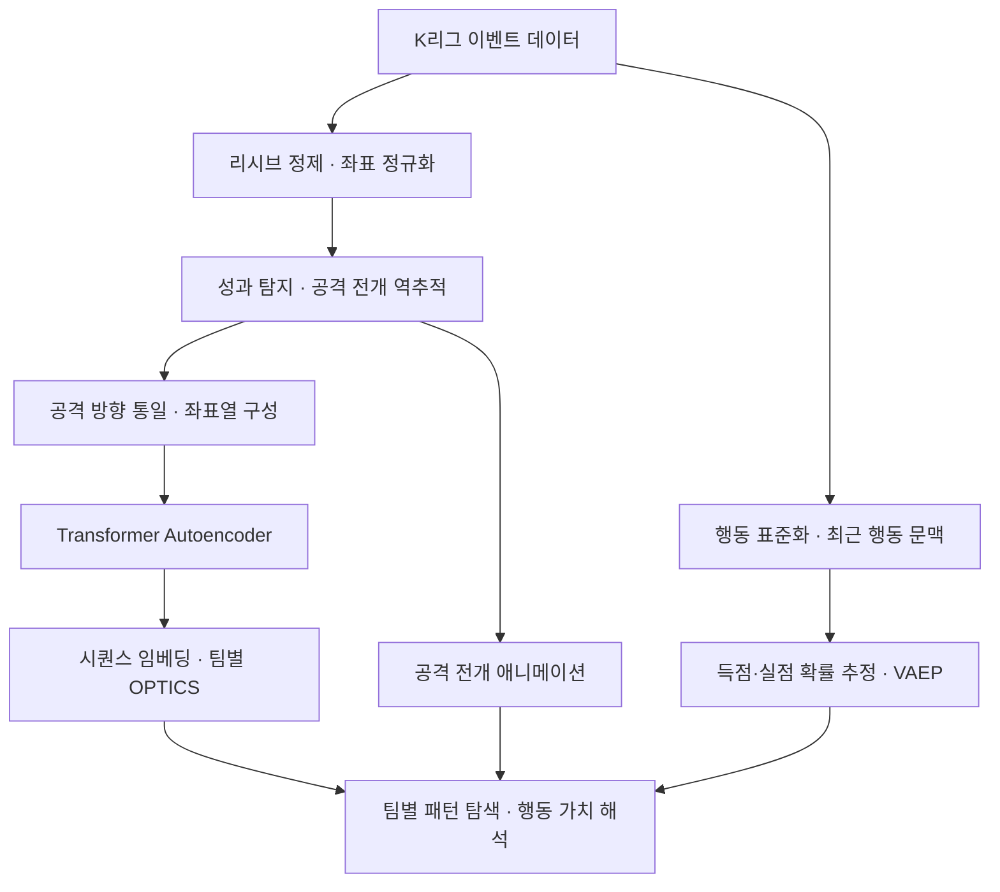

# deTACTer

**K리그 이벤트 데이터에서 반복되는 공격 전개를 발견하고, 각 행동의 가치를 함께 해석하는 전술 분석 프로젝트.**

`Football Analytics` · `Sequence Representation Learning` · `VAEP` · `Team-wise Clustering`

**[웹사이트 바로가기](https://de-tac-ter.vercel.app/)** · **[YouTube에서 보기](https://www.youtube.com/watch?v=cMdmHzS3dso)**

https://github.com/user-attachments/assets/b42762e2-34f7-4d5b-82dd-311a3e4aa445

- **연구 질문** — 슈팅과 박스 진입에 앞선 공격 전개에서 반복되는 공간 패턴을 찾고, 그 과정의 어떤 행동이 득점 기회를 높이거나 실점 위험을 낮췄는지 설명할 수 있는가?
- **접근** — 성과 지점에서 공격 전개를 역추적하고, Transformer Autoencoder로 좌표열을 표현한 뒤 팀별로 군집화. VAEP 행동 가치와 애니메이션을 결합하여 패턴과 개별 행동을 함께 분석.
- **데이터** — K리그 **198경기 · 12개 팀 · 579,306개 이벤트**. 대시보드에서 **205개 공격 시퀀스** 탐색.
- **프로젝트** — DACON K리그 경기 데이터 기반 AI 서비스 개발 · 팀 deTACTer · 김태현.

## Research problem

- **결과만으로는 설명하기 어려운 공격 과정** — 슈팅 수와 득점 수는 공격의 결과를 요약하지만, 기회를 만들기까지 어떤 경로를 거쳤는지는 보여주지 못함. 패스와 운반을 연결한 전개 과정 자체를 분석 단위로 설정.
- **반복성과 가치의 구분** — 자주 등장하는 전개가 반드시 높은 가치를 갖는 것은 아님. 공간적으로 유사한 공격을 찾는 문제와 각 행동의 가치를 추정하는 문제를 분리하여 분석.
- **비교 가능한 시퀀스의 필요성** — 같은 공격도 진영, 기록 방식, 이벤트 경계에 따라 다른 좌표열로 나타날 수 있음. 표현 학습에 앞서 방향·연속성·중복·종료 조건을 정의하는 것이 핵심 과제.
- **전술 패턴의 정의** — 여기서 패턴은 성과에 이르는 이벤트 좌표열의 반복적 형태를 의미. 감독의 의도나 선수 전체의 움직임을 직접 관측한 전술 라벨은 아님.

## Research design

- **성과를 기준으로 분석 단위 구성** — 슈팅 또는 상대 박스 내 행동에서 출발해 이전 전개를 역추적. 임의의 시간 구간보다 공격의 도착 지점을 명확히 정의하려는 설계.
- **좌표 재구성으로 전개 표현 학습** — 사람이 전술 유형을 미리 붙이지 않고 좌표열을 복원하도록 학습. 행동 사이의 공간 관계를 담는 임베딩을 군집화에 활용.
- **팀별 반복 패턴 발견** — 각 팀의 시퀀스를 따로 분석하여 팀 내부의 반복성을 탐색. 군집 수를 사전에 정하지 않고, 밀도가 낮은 사례는 별도로 남김.
- **행동 가치로 해석 보완** — 패턴의 유사성은 임베딩으로, 행동의 기여는 VAEP로 설명. VAEP를 임베딩 입력에 포함하지 않아 두 분석의 역할을 구분.

## Method

### 1. 이벤트를 연속된 공격 전개로 정제

- **관측 정보** — 경기·피리어드·시간, 팀·선수, 행동 유형과 결과, 시작·종료 좌표를 사용. 이벤트 사이의 위치는 연속적으로 관측되지 않음.
- **공간 기준 통일** — 105 × 68m 경기장 기준으로 범위를 보정하고 좌표를 0–1로 정규화. 공격 방향은 시퀀스를 구성한 뒤 공격팀 기준으로 통일.
- **중복과 이동의 분리** — 후속 행동과 겹치는 리시브는 제거하고, 이동을 포함한 리시브는 공을 운반하는 행동으로 변환하거나 인접한 운반 행동에 병합.
- **연속성 판단** — 정제 후 이전 행동의 종료점과 다음 행동의 시작점 사이 간극을 검사. 허용 오차를 넘는 단절은 역추적 경계로 사용하여 서로 연결되지 않은 장면이 한 공격으로 묶이는 것을 제한.

### 2. 성과 지점에서 공격 시퀀스를 역추적

- **성과 후보** — 슈팅 또는 상대 박스 영역에서 시작하는 유효 행동. 태클·인터셉트·클리어링·골키퍼 수비 행동은 성과 후보에서 제외.
- **방향 판별** — 경기·피리어드·팀별 골키퍼 평균 위치로 공격 방향을 추정. 시퀀스 안의 양 팀 이벤트에 같은 좌표 변환을 적용하여 상대적 위치 관계를 유지.
- **공간 범위** — 왼쪽에서 오른쪽으로 공격할 때 정규화 좌표의 x > 0.84, 0.36 < y < 0.635를 박스 내 분석 영역으로 사용. y 범위는 슈팅에도 적용하므로 전체 박스와 모든 슈팅을 포괄하지 않는 선택적 정의.
- **시퀀스 경계** — 성과에서 과거로 이동하다 경기·피리어드 변경, 재사용된 행동, 공격팀의 좌표 단절 또는 세트피스를 만나면 추적 종료. 상대팀의 개입도 시퀀스 후보에 포함.
- **추출 조건** — 목표 공격팀 행동 수 8개, 성과가 아닌 행동 중 순수 패스 최소 3개, 전체 이벤트 최소 5개. 경계에서 조기 종료되거나 상대팀 행동이 포함되므로 실제 시퀀스 길이는 달라질 수 있음.
- **혼전 제외** — 성과 이전의 비성과 행동이 이미 지정 박스 안에서 시작하는 시퀀스는 제외. 박스 안에서 이어지는 혼전보다 박스에 도달하기까지의 전개에 분석 초점을 맞춤.

### 3. 공격 전개의 공간 표현 학습

- **입력** — 성과에서 과거로 정렬한 행동 시작 좌표열. 팀·선수 이름이나 VAEP를 사용하지 않고 공간 경로를 표현.
- **모델 선택** — 행동 사이의 관계를 함께 고려할 수 있는 self-attention을 활용. Transformer의 시퀀스 표현 원리를 좌표 재구성에 적용한 설계이며, 원 논문의 번역 모델과는 목적이 다름. [Vaswani et al., 2017](https://proceedings.neurips.cc/paper/2017/hash/3f5ee243547dee91fbd053c1c4a845aa-Abstract.html).
- **학습 목표** — 위치 정보를 더한 좌표열을 인코딩한 뒤 입력 좌표를 복원하도록 학습. 재구성 평균제곱오차(MSE)를 최소화하여 전개의 공간 정보를 보존하도록 유도.
- **시퀀스 표현** — 유효한 위치의 인코더 표현을 평균하여 하나의 임베딩으로 요약. 짧은 좌표열은 패딩하고 긴 좌표열은 절단하여 길이 8에 맞춤.
- **증강** — 학습 시 경기장 폭 방향을 반전하여 좌우 측면의 대칭적인 전개를 함께 학습. 시간 정보와 행동 유형은 이 임베딩의 입력에 포함하지 않음.

### 4. 팀별로 반복되는 패턴 발견

- **팀 단위 분석** — 임베딩을 팀별로 분리하여 각 팀 안에서 비슷한 공격 전개를 탐색. 팀 사이의 동일 군집 번호가 같은 패턴을 의미하지는 않음.
- **OPTICS 선택** — 군집 수를 미리 정하기 어렵고 반복 빈도가 고르지 않은 공격들을 분석하기 위해 밀도 기반 방법을 적용. OPTICS는 데이터의 밀도 구조를 드러내는 순서를 구성하며, 그 구조에서 군집을 추출할 수 있음. [Ankerst et al., 1999](https://sigmodrecord.org/publications/sigmodRecord/9906/OPTICS_%20ordering%20points%20to%20identify%20the%20clustering%20structure.pdf).
- **군집과 예외** — 임베딩 사이의 Euclidean 거리를 사용하고, 충분한 밀도를 형성하지 못한 시퀀스는 노이즈로 구분. 희소한 공격을 무조건 기존 패턴에 배정하지 않음.
- **해석** — 군집은 반복되는 공간 형태를 제시. 그 패턴의 전술적 의미는 개별 시퀀스와 행동 가치를 함께 보며 해석해야 함.

### 5. VAEP로 행동 가치 추정

- **평가 관점** — 행동 직전과 직후의 득점·실점 가능성 변화를 이용해 패스, 운반, 슈팅 등의 가치를 평가. 단순 성공 여부보다 행동이 발생한 문맥을 고려하는 VAEP 접근을 적용. [Decroos et al., 2019](https://doi.org/10.1145/3292500.3330758).
- **상태 표현** — 행동을 SPADL 형식으로 표준화하고, 현재 행동을 포함한 최근 3개 행동으로 경기 상태를 표현. 유형·결과·시간·위치·이동·팀 관계를 활용.
- **확률 모델** — CatBoost 분류기 두 개로 가까운 미래의 득점과 실점 여부를 각각 예측. 기본 예측 구간은 다음 10개 행동이며 탐색된 설정에 따라 조정.
- **가치 계산** — 같은 팀 관점에서 득점 확률의 증가량과 실점 확률의 감소량을 합산. 소유권이 바뀌는 경우에도 평가 대상 팀의 관점을 맞추어 비교.

$$
V(a_i)=\bigl[P_{score}(S_i,t)-P_{score}(S_{i-1},t)\bigr]
      +\bigl[P_{concede}(S_{i-1},t)-P_{concede}(S_i,t)\bigr]
$$

- **기호** — aᵢ는 평가할 행동, Sᵢ는 행동 이후 상태, t는 평가 대상 팀. 양의 값은 모델이 추정한 공격·수비 측면의 순가치가 개선되었음을 의미.
- **설명 예시** — 득점 확률이 0.02에서 0.05로 증가하고 실점 확률이 0.01에서 0.008로 감소했다면 행동 가치는 0.032. 이는 계산 원리를 보여주는 예시이며 실제 경기 측정값은 아님.
- **패턴과의 연결** — 유사한 경로의 공격에서도 어느 행동이 기회를 확대했는지를 비교. 높은 VAEP를 감독의 의도나 실제 득점에 대한 인과적 증거로 해석하지 않음.

### 6. 분석 결과를 시각적으로 해석

- **탐색 흐름** — 팀을 선택하고 공격 시퀀스를 살펴본 뒤, 전개 애니메이션과 행동별 가치 변화를 함께 확인.
- **전개 시각화** — 이벤트 위치 사이를 보간하여 공과 선수의 이동을 표시. 관측되지 않은 구간을 연결한 표현이므로 실제 트래킹 영상과 구분.
- **분석가의 역할** — 발견된 군집을 검토하고 전개 방식에 의미를 부여하는 탐색 도구. 자동 군집 결과 자체가 완성된 전술 분류 체계는 아님.

## Engineering decisions

### 1. 좌표 반전으로 공격 궤적이 끊기는 문제

- **문제·원인** — 공격팀과 상대팀 이벤트를 각각의 공격 방향으로 반전하면 같은 장면 안에서 서로 다른 좌표계가 섞여 공이 경기장 반대편으로 이동하는 것처럼 보임.
- **판단·해결** — 방향 정규화의 단위를 개별 팀 이벤트에서 공격 시퀀스로 변경. 공격팀의 방향을 기준으로 상대팀 이벤트까지 같은 변환을 적용.
- **의미** — 공격과 수비 행동 사이의 상대적 위치를 유지하도록 설계하여, 방향 차이가 별도 패턴으로 학습되는 오류를 줄이는 기반 마련.

### 2. 리시브 중복과 이동 누락이 전개를 왜곡하는 문제

- **문제·원인** — 후속 패스와 겹치는 리시브는 같은 위치를 중복 기록하고, 리시브와 다음 행동 사이의 누락된 이동은 경로에 간극을 만듦.
- **판단·해결** — 중복 기록과 실제 이동 정보를 분리. 중복 리시브는 제거하고 이동을 담은 리시브는 운반 행동으로 변환·병합하여 전개를 연결.
- **의미** — 기록 방식의 차이가 공격 길이와 경로를 좌우하지 않도록 정제. 보정된 운반 구간은 관측 정보에 기반한 추정이라는 한계를 유지.

### 3. 하나의 공격이 여러 패턴으로 중복 집계되는 문제

- **문제·원인** — 박스 진입 뒤 슈팅과 후속 행동이 연속되면 각 성과 후보에서 역추적한 구간이 겹치고, 박스 주변 혼전까지 별도 공격으로 집계될 수 있음.
- **판단·해결** — 이미 선택한 행동을 만나면 역추적을 종료하고, 성과 이전 행동이 지정 박스 내부에서 시작하는 시퀀스를 제외. 고정된 대기 간격보다 전개의 경계와 공간 조건을 사용.
- **의미** — 동일 장면의 반복 집계를 제한하고 박스 도달 이전의 전개에 초점. 대신 박스 안에서 시작되는 의미 있는 공격도 제외될 수 있는 선택 편향이 존재.

### 4. 연결되지 않은 장면이 하나의 공격으로 묶이는 문제

- **문제·원인** — 시간상 이웃한 이벤트가 반드시 공간적으로 이어지는 것은 아니며, 이를 그대로 묶으면 비현실적인 장거리 이동을 학습하게 됨.
- **판단·해결** — 리시브와 이동을 먼저 보정한 뒤 좌표 단절을 판별하고, 공격팀의 단절 지점에서 역추적을 종료.
- **의미** — 보정 가능한 간극과 분석 경계로 삼아야 할 단절을 구분. 이후 경로 분석의 전제인 연속성을 추출 과정에서 관리.

### 5. 군집 점수와 분석 목적이 어긋나는 문제

- **문제·원인** — 시퀀스 길이·최소 패스 수와 군집 점수를 함께 최적화하면, 표현이 좋아진 것인지 분석 대상 자체가 쉬워진 것인지 구분하기 어려움.
- **판단·해결** — 목표 길이 8·최소 패스 3으로 추출 조건을 고정하고, 표현 학습의 목적을 좌표 재구성 오차 최소화로 변경. 군집 형성은 학습된 표현을 해석하는 후속 단계로 분리.
- **의미** — 모델 선택의 기준을 명확히 했으나 재구성 오차가 낮다는 사실만으로 전술적 유용성을 입증할 수는 없음. 패턴의 안정성과 전문가 해석은 별도 평가 대상.

### 6. 분석 결과와 영상이 연결되지 않는 문제

- **문제·원인** — 결과 저장 위치와 파일명이 달라지면 군집·시퀀스와 영상의 대응이 끊기고, 인코딩 환경 차이로 시각화 산출물이 누락됨.
- **판단·해결** — 팀·군집·시퀀스의 대응 관계를 기준으로 영상 명명과 탐색을 통일하고, 인코딩 실패 시 사용할 대체 경로 마련.
- **의미** — 분석 결과를 해당 장면으로 추적할 수 있게 정리. 최종 데이터와 영상의 누락·불일치 확인은 재생성 과정에서 계속 필요.

## Experimental setup

| 구분 | 설정 | 평가 목적 |
| --- | --- | --- |
| 분석 단위 | 목표 공격팀 행동 8개 · 비성과 패스 최소 3개 · 전체 이벤트 최소 5개 | 비교할 공격 전개의 조건 고정 |
| 표현 학습 | Transformer Autoencoder · 길이 8 · 폭 방향 반전 증강 | 좌표열의 공간 정보 재구성 |
| 모델 탐색 | TPE 50회 · 탐색당 15 epochs | 재구성 MSE 최소화 |
| 탐색 범위 | 임베딩 차원 32–512 · 층 1–8 · attention head 2–16 · dropout 0.1–0.3 | 표현 용량과 정규화 조정 |
| 최적화 설정 | 학습률 0.0001–0.01 · 배치 크기 16·32·64 | 학습 조건 탐색 |
| 최종 학습 | 시퀀스 순서 기준 90:10 분할 · 최대 100 epochs · 10회 연속 미개선 시 조기 종료 | 재학습 중 오차 모니터링 |
| 군집화 | 팀별 OPTICS · 기본 최소 이웃 수 3 · 밀도 변화 기준 0.01 | 반복 패턴과 저밀도 사례 분리 |
| 가치 평가 | CatBoost 득점·실점 모델 · 행동 단위 무작위 5-fold · Brier score | 확률 예측 오차 평가 |

- **표현 학습 지표** — 패딩 부분의 오차를 0으로 만든 뒤 MSE 계산. 평균의 분모에는 패딩 위치가 포함되므로 유효 길이에 영향을 받을 수 있음.
- **확률 평가 지표** — Brier score는 예측 확률과 실제 발생 여부의 제곱 오차 평균으로, 낮을수록 확률 예측 오차가 작음.
- **평가 구분** — 좌표 재구성, 득점·실점 확률 예측, 군집의 전술적 해석은 서로 다른 평가 대상. 한 지표의 개선을 전체 분석의 우수성으로 일반화하지 않음.

## Results & limitations

| 항목 | 결과 | 해석 범위 |
| --- | --- | --- |
| 분석 데이터 | 198경기 · 12팀 · 579,306개 이벤트 | 이벤트 기반 공격 전개 분석 |
| 대시보드 | 12팀의 공격 시퀀스 205개 | 개별 전개와 행동 가치 탐색 |
| 표현 학습 | 50회 탐색에서 최소 재구성 MSE 0.000360 보고 | 탐색 목적함수 값이며 독립 테스트 성능은 아님 |

- **확인한 범위** — 이벤트 정제, 성과 중심 추출, 공간 표현 학습, 팀별 군집화와 행동 가치 시각화를 연결한 분석 흐름을 구성. 재구성 오차의 개선이 전술 발견의 정확도나 경기 성과 향상을 뜻하지는 않음.
- **독립 검증 부족** — TPE 탐색은 같은 시퀀스를 학습·평가에 사용하며 증강 여부만 다름. VAEP도 경기 단위가 아닌 행동 단위로 분할하므로 인접 상태가 학습·평가에 함께 들어갈 수 있음. 미관측 경기 일반화 성능은 미확인.
- **분석 대상의 편향** — 슈팅·지정 박스 조건과 최소 패스 수를 만족한 공격을 선택하므로 실패한 공격, 짧은 역습, 박스 내부 전개 전체를 대표하지 않음.
- **관측의 한계** — 이벤트 좌표만으로 오프더볼 움직임, 수비 대형과 압박, 실제 이동 경로, 전술적 의도를 복원할 수 없음. 골키퍼 위치가 부족한 장면에서는 공격 방향 추정도 불확실.
- **표현의 한계** — 위치 중심 입력은 같은 경로를 다른 속도나 행동 구성으로 수행한 공격을 구분하는 데 제약이 있음. 평균 임베딩과 길이 제한이 세부 순서 정보를 충분히 보존하는지도 검증 필요.
- **재현의 한계** — 처음부터 재실행하려면 행동 식별자를 맞추고, 정제된 공격과 가치 평가의 매칭, 팀별 군집과 화면 데이터의 연결, 최종 시퀀스와 통계의 동기화를 확인해야 함. 실패한 탐색의 처리와 최적 모델 상태 보존도 추가 보완 대상.

## Next steps

- **경기 단위 일반화 평가** — 학습·검증·테스트를 경기 단위로 분리하고 여러 난수 초기값에서 반복하여 재구성 오차와 확률 예측의 변동성 측정.
- **표현 학습의 기여 검증** — 원시 좌표, DTW 기반 경로 비교, GRU와 동일한 데이터 분할로 비교. 시간·행동 유형을 추가했을 때 구분력이 개선되는지 평가.
- **전처리 결정의 기여 검증** — 방향 통일, 리시브 보정, 중복 제한, 단절 경계를 각각 제거하는 ablation으로 시퀀스 품질과 군집 안정성 변화 측정.
- **전술적 유용성 검증** — 전문가의 패턴 해석 일치도와 사례 탐색 효율을 평가하고, 군집 밀도와 행동 가치가 서로 어떤 정보를 제공하는지 분석.
- **확률 신뢰도 검증** — 득점·실점의 낮은 발생 빈도를 고려한 기준 모델과 비교하고, 예측 확률과 실제 발생률의 일치 여부를 평가.

## References

- **[1] VAEP / SPADL** — Decroos, T., Bransen, L., Van Haaren, J., & Davis, J. (2019). *Actions Speak Louder than Goals: Valuing Player Actions in Soccer*. KDD, 1851–1861. [DOI: 10.1145/3292500.3330758](https://doi.org/10.1145/3292500.3330758). 행동을 표준화하고 득점·실점 확률 변화로 평가하는 방법론의 근거.
- **[2] VAEP 확장 초록** — Decroos, T., Bransen, L., Van Haaren, J., & Davis, J. (2020). *VAEP: An Objective Approach to Valuing On-the-Ball Actions in Soccer (Extended Abstract)*. IJCAI, 4696–4700. [DOI: 10.24963/ijcai.2020/648](https://doi.org/10.24963/ijcai.2020/648).
- **[3] Transformer** — Vaswani, A., et al. (2017). *Attention Is All You Need*. NeurIPS 30. [논문](https://proceedings.neurips.cc/paper/2017/hash/3f5ee243547dee91fbd053c1c4a845aa-Abstract.html). Self-attention 기반 시퀀스 표현의 근거.
- **[4] OPTICS** — Ankerst, M., Breunig, M. M., Kriegel, H.-P., & Sander, J. (1999). *OPTICS: Ordering Points To Identify the Clustering Structure*. SIGMOD, 49–60. [논문](https://sigmodrecord.org/publications/sigmodRecord/9906/OPTICS_%20ordering%20points%20to%20identify%20the%20clustering%20structure.pdf). 밀도 구조에 기반한 패턴 탐색의 근거.
- **[5] VAEP 도구** — ML-KULeuven. *socceraction*. [공식 문서](https://socceraction.readthedocs.io/en/latest/documentation/valuing_actions/vaep.html). SPADL과 VAEP 계산에 활용.
