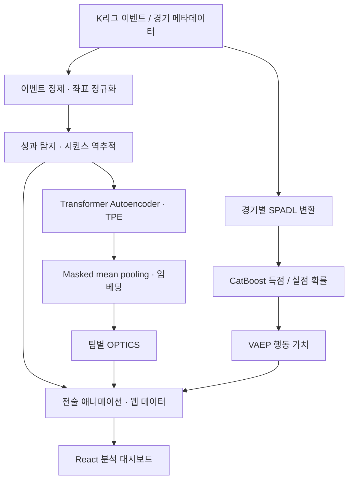

# deTACTer

**K리그 이벤트 데이터에서 반복되는 공격 패턴을 추출하고, 행동의 가치와 함께 해석하는 전술 분석 프로젝트.**

`Football Analytics` · `Sequence Representation Learning` · `VAEP` · `Team-wise Clustering`

- **연구 질문** — 슈팅과 득점에 앞선 공격 전개를 어떻게 비교 가능한 시퀀스로 표현하고, 반복되는 패턴과 개별 행동의 가치를 함께 설명할 수 있는가?
- **접근** — 이벤트 정제 → 성과 기반 시퀀스 추출 → Transformer Autoencoder → 팀별 OPTICS로 패턴을 구성하고, 별도 VAEP 모델의 행동 가치를 애니메이션과 대시보드에 연결.
- **분석 범위** — 로컬 원본 기준 **198경기 · 12개 팀 · 579,306개 이벤트**. 제출본 웹 데이터에는 **205개 시퀀스** 수록.
- **프로젝트 맥락** — DACON K리그 경기 데이터 기반 AI 서비스 개발 프로젝트. 팀 deTACTer; 기존 제출 문서에 기재된 참여자: 김태현. 개인별 역할·기여율은 별도 기록이 없어 기재하지 않음.
- **버전** — v5.9 연구 프로토타입. 이 저장소는 기존 코드와 연구 기록을 보존한 포트폴리오 정리본이며, 학습 알고리즘은 변경하지 않음.

[실행·재현 안내](docs/reproduction.md) · [문제 해결 기록](docs/research/engineering-log.md) · [버전 기록](docs/versions/v5.9.md) · [참고 문헌](docs/references/README.md)

- **산출물** — [최종 발표 자료](docs/reports/final-report.pdf) · [인증서](docs/reports/certificate.pdf). 전체 시연 영상은 `docs/media/`에 로컬 보관.

## Research contributions

- **분석 단위 설계** — 슈팅 및 상대 박스 내 행동을 기준으로 역추적하여 공격 시퀀스를 구성. 단절점, 세트피스, 경기·피리어드 경계, 액션 중복 조건을 적용해 비교 대상의 범위를 명시.
- **표현 학습과 가치 평가의 결합** — 좌표 시퀀스의 재구성으로 공간 패턴을 학습하고, VAEP로 각 행동의 득점·실점 확률 변화량을 설명. VAEP는 현재 임베딩의 입력 피처가 아니라 별도의 해석 지표.
- **팀별 패턴 발견** — 임베딩을 팀 단위로 분리한 뒤 OPTICS를 적용하여 반복 패턴과 밀도가 낮은 사례를 구분. 군집 수를 사전에 지정하지 않는 분석 흐름 구현.
- **분석 결과의 전달** — 팀·시퀀스 탐색, 행동별 VAEP 차트, 선수·공 이동 애니메이션을 React 대시보드에 연결. 영상은 이벤트 사이를 보간한 시각화이며 실제 트래킹 궤적은 아님.

## Pipeline



- **읽는 기준** — 아래는 실제 코드의 데이터 흐름. 기존 통합 실행기는 SPADL 생성과 웹 데이터 준비를 호출하지 않으며, 처음부터의 재학습에는 [재현 전제와 미해결 연결 지점](docs/reproduction.md)을 먼저 확인해야 함.

### 1. Event preprocessing

- **입력** — `data/raw_data.csv`, `data/match_info.csv`; 경기·피리어드·시간·액션 ID, 팀·선수, 이벤트 유형·결과, 시작·종료 좌표 활용.
- **좌표 처리** — 105 × 68 기준으로 범위를 클리핑하고 좌표를 `[0, 1]`로 정규화. 이 단계에서는 팀별 공격 방향을 반전하지 않음.
- **리시브 보정** — 다음 행동과 시작 좌표가 중복되는 리시브 제거; 이동 리시브는 Carry로 변환하거나 다음 Carry에 병합; 정적 리시브와 후속 행동 사이 간극 보정.
- **연속성 판별** — 보정 후 이전 종료점과 현재 시작점 간 정규화 거리 `> 1e-3`를 `is_dis`로 표시. 좌표 이동량과 시간 차이도 계산.
- **출력 / 코드** — `data/refined/v5.9/preprocessed_data.csv` · [preprocessing.py](scripts/preprocessing.py).

### 2. Action valuation — VAEP

- **별도 입력 경로** — 원시 이벤트를 경기별 `data/spadl/game_*.csv`로 변환. 전처리 CSV에 추가한 `spadl_type` 열만으로 경기별 SPADL 파일이 생성되지는 않음.
- **상태 표현** — 현재 행동을 포함한 최근 3개 행동을 상태로 구성. 액션 유형·결과·신체 부위, 시간, 시작·종료 위치, 이동 및 행동 간 공간 차이, 팀 정보를 피처로 사용.
- **확률 추정** — CatBoost 이진 분류기 두 개로 향후 `nr_actions` 이내 득점·실점 여부를 각각 예측. 예측 구간은 최적 파라미터 파일을 우선 사용하며 없으면 10개 행동.
- **평가 방식** — 행동 행 단위 shuffled 5-fold 예측을 모아 Brier score 계산. 경기 단위 분할은 아니므로 동일 경기의 인접 상태가 학습·평가에 함께 포함될 수 있음.
- **가치 산정** — 같은 팀 관점에서 행동 전후의 득점 확률 증가와 실점 확률 감소를 합산. 실제 계산은 소유권 전환 등을 처리하는 `socceraction.vaep.formula.value` 사용. [VAEP 원 논문](https://doi.org/10.1145/3292500.3330758), [공식 구현 설명](https://socceraction.readthedocs.io/en/latest/documentation/valuing_actions/vaep.html).
- **출력 / 코드** — `vaep_values.csv`, `vaep_summary_stats.csv` · [convert_to_spadl.py](scripts/convert_to_spadl.py), [compute_vaep.py](scripts/compute_vaep.py).

$$
V(a_i)=\bigl[P_{score}(S_i,t)-P_{score}(S_{i-1},t)\bigr]
      +\bigl[P_{concede}(S_{i-1},t)-P_{concede}(S_i,t)\bigr]
$$

### 3. Outcome-conditioned sequence extraction

- **성과 정의** — 슈팅 또는 상대 박스 영역에서 시작하는 유효 행동. 공격 방향은 경기·피리어드·팀별 GK 평균 위치로 추정하고, 수비 행동은 성과 후보에서 제외.
- **공간 조건** — L→R 기준 박스 판정은 `x > 0.84`, `0.36 < y < 0.635`. y 조건은 슈팅 후보에도 적용하므로 전체 슈팅을 포괄하는 정의는 아님.
- **역추적 경계** — 경기·피리어드 변경, 이미 사용한 `action_id`, 공격팀의 단절 이벤트, 세트피스 등을 기준으로 탐색 종료. 상대팀 행동도 시퀀스 후보에 포함.
- **v5.9 설정** — 목표 공격팀 액션 수 8, 성과가 아닌 이벤트 중 순수 `Pass` 최소 3개, 전체 이벤트 최소 5개. 경계에서 조기 종료되거나 상대팀 이벤트가 포함되므로 모든 원시 시퀀스가 정확히 8행인 것은 아님.
- **혼전 제외** — 성과가 아닌 이벤트가 지정 박스 내부에서 시작하는 시퀀스 제외. 이후 공격팀 기준으로 시퀀스 전체 좌표를 함께 반전하고 성과 y 범위를 재확인.
- **출력 / 코드** — `attack_sequences.csv`, `attack_sequences_stats.csv` · [sequence_extraction.py](scripts/sequence_extraction.py).

### 4. Representation learning

- **입력 표현** — `seq_position` 오름차순으로 정렬한 `(start_x, start_y)` 좌표열. 현재 저장 규칙에서 성과에 가까운 행동의 번호가 작으므로 모델은 성과→과거 순서를 사용.
- **모델** — 2차원 좌표 투영 → 학습 가능한 위치 인코딩 → Transformer Encoder → 좌표 재구성. 마스킹한 토큰 표현의 평균으로 시퀀스 임베딩 생성; GRU 비교 구현도 보존.
- **학습** — 길이 8에 맞춘 패딩·절단과 학습 시 y-flip 증강 적용. 손실은 패딩 좌표를 0으로 마스킹한 텐서의 MSE이며, 평균 분모에는 패딩 위치도 포함됨.
- **TPE 탐색** — 기본 통합 실행 50 trials, trial당 15 epochs. hidden dimension `{32,64,128,256,512}`, layer 수 `1–8`, dropout `0.1–0.3`, learning rate `1e-4–1e-2`, batch size `{16,32,64}`, head 수 `{2,4,8,16}` 탐색.
- **최적화 목표** — v5.9는 재구성 MSE 최소화. 탐색 코드의 학습·평가 시퀀스는 동일하며 증강 여부만 다름; 따라서 탐색 점수를 독립 검증 성능으로 해석하지 않음.
- **최종 학습** — 시퀀스 순서 기준 90:10 분할, 최대 100 epochs, patience 10. 탐색 DB·학습 로그·체크포인트 저장.
- **출력 / 코드** — `results/models/v5.9/transformer_best.pth`, `results/embeddings/v5.9/transformer_embeddings.npy`, `transformer_metadata.csv` · [학습](scripts/train_embedding_model.py), [임베딩 추출](scripts/extract_embeddings.py).

### 5. Team-wise pattern discovery

- **입력 정렬** — `sequence_id`로 임베딩 메타데이터와 팀 정보를 결합하고 팀별로 분리.
- **군집화** — Euclidean 거리 기반 OPTICS; 기본 `min_samples=3`, `xi=0.01`. 팀별 표본 수에 따라 최소 샘플 수를 조정하고, 5개 미만 팀은 건너뜀.
- **결과 해석** — 군집은 좌표 패턴의 반복성을 나타내며 노이즈 라벨은 `-1`. 군집 품질이 전술적 우수성이나 승리 기여를 직접 입증하지는 않음.
- **최종 경로** — v5.9 최종 실행기는 팀별 OPTICS를 사용. 기존 README에 적힌 Grid Grouping + OPTICS는 이 실행 경로의 필수 단계가 아님.
- **출력 / 코드** — `results/clustering/v5.9/transformer/<팀명>/team_clusters.csv` · [team_based_clustering.py](scripts/team_based_clustering.py).

### 6. Visualization & delivery

- **애니메이션** — 팀·군집·시퀀스 ID를 파일명에 반영하고 선수·공 이동을 보간하여 MP4 생성.
- **웹 데이터** — 시퀀스 통계, 행동 좌표, VAEP, 군집 및 영상 경로를 JSON으로 변환. 현재 웹 준비 스크립트는 통합 군집 CSV를 읽으므로 팀별 결과와의 연결에는 추가 정합성 확인이 필요.
- **화면** — React 19 · Vite 7 · Tailwind CSS · Recharts · Framer Motion으로 팀 필터, 시퀀스 탐색, 행동별 가치 차트 제공.
- **출력 / 코드** — `results/animations/v5.9/transformer/`, `web/src/data/sequences.json` · [영상 생성](scripts/team_animations.py), [웹 데이터 변환](scripts/prepare_web_data.py), [분석 화면](web/src/pages/Analysis.jsx).

## Engineering decisions

- **상대팀 이벤트가 섞일 때 궤적이 반전됨 → 반전 단위를 시퀀스로 변경.** 전처리 단계의 팀별 좌표 반전을 제거하고, 공격팀 기준으로 상대팀 이벤트까지 함께 반전하여 좌표계 일관성을 확보. [구현](scripts/sequence_extraction.py)
- **리시브 중복과 Carry 누락으로 궤적이 파편화됨 → 중복 제거·이동 보정 분리.** 제자리 중복 리시브는 삭제하고 이동 정보는 Carry 변환·병합으로 유지. [구현](scripts/preprocessing.py)
- **동일 공격이 여러 시퀀스로 집계됨 → 액션 재사용 경계 도입.** 사용된 액션을 만나면 역추적을 종료하고 박스 내부 혼전 필터를 적용. 과거의 5-action 불응기는 이후 제거되어 현재 해결 방식과 구분. [기록](docs/research/engineering-log.md), [현재 구현](scripts/sequence_extraction.py)
- **좌표 불연속을 공격 전개로 학습함 → 정제 후 단절점을 계산.** `is_dis`를 추출 종료 조건으로 사용해 끊긴 궤적이 하나의 패턴으로 이어지는 것을 제한. [v5.5 기록](docs/versions/v5.5.md)
- **군집 점수 중심 탐색에서 시퀀스 정의까지 변함 → 추출 조건 고정·재구성 목표로 전환.** v5.9에서 길이 8·최소 패스 3을 고정하고 MSE를 최적화하여 표현 학습의 목적을 명시. 전술 품질 개선을 입증하려면 별도 평가가 필요. [v5.8](docs/versions/v5.8.md), [v5.9](docs/versions/v5.9.md)
- **영상 파일 탐색·인코딩 문제가 발생함 → 명명 규칙·재귀 탐색·대체 인코딩 적용.** 시퀀스 ID를 파일명에서 복원하고 하위 폴더를 검색하며 ImageIO 대체 경로를 마련. 실제 영상 연결 여부는 별도 검증 대상. [웹 변환](scripts/prepare_web_data.py), [인코딩](scripts/animate_tactics.py)

## Evidence & evaluation

| 항목 | 확인 내용 | 근거와 해석 범위 |
| --- | --- | --- |
| 원본 데이터 규모 | 579,306 이벤트 / 198경기 / 12팀 | 로컬 `raw_data.csv` 직접 집계; Git에는 원시 데이터 미포함 |
| 제출본 웹 데이터 | 205 시퀀스 / 12팀 | 보존된 `sequences.json` 직접 집계; 재학습 결과가 아님 |
| 영상 메타데이터 | 107개 시퀀스에 영상 URL 존재 | 개별 전술 MP4는 제출 코드 폴더에 없음; 재생 가능 수를 뜻하지 않음 |
| v5.9 실험 기록 | 50 trials, 최소 MSE 0.000360, 6개 군집·대표 영상 | 당시 [walkthrough](docs/versions/v5.9.md)의 보고값; 로그·모델을 통한 재검증 미실시, 팀별 최종 결과와 동일하다고 가정하지 않음 |

- **평가 한계** — TPE의 학습·평가 시퀀스 중복, VAEP의 행동 단위 분할, 최종 모델의 단일 순서 분할로 인해 독립 경기 일반화 성능은 미확인.
- **해석 한계** — 이벤트 데이터만으로 오프더볼 움직임·수비 대형·의도를 복원할 수 없음. 성과 조건을 만족한 공격만 추출하므로 실패한 공격 전체로 결론을 확장하지 않음.
- **후속 검증** — 경기 단위 holdout, seed 반복 실험, 확률 calibration, 좌표·DTW·GRU 비교, 전문가 군집 해석 평가가 필요. 계획 단계이며 완료된 결과로 제시하지 않음.

## Repository structure

```text
deTACTer/
├── README.md                 # 연구 질문·방법·근거·한계
├── config.yaml               # v5.9 설정
├── requirements.txt          # Python 의존성 목록
├── scripts/                  # 기존 분석 코드·실행 경로 보존
├── notebooks/                # 탐색·오류 분석·실험 노트북
├── web/                      # React 대시보드; 제출본 JSON은 로컬 보관
├── data/                     # 로컬 입력·중간 데이터; Git 제외
├── results/                  # 새 실행 산출물; Git 제외
├── docs/
│   ├── reproduction.md       # 실행 조건·연결 지점·검증 범위
│   ├── organization.md       # 파일 이동 및 보존 내역
│   ├── research/             # 기획·선행연구·문제 해결 기록
│   ├── versions/             # 버전별 실험 기록 원문
│   ├── references/           # VAEP 문헌·BibTeX·보관 논문
│   ├── reports/              # 기존 최종 산출물·인증서
│   └── media/                # 기존 전체 데모 영상; 로컬 보관
└── archive/
    ├── runners/              # 과거 루트 실행 도구
    ├── releases/v5.9/        # 기존 제출 폴더 원본; 로컬 보관
    ├── results/              # 버전 미지정 과거 결과
    ├── scripts/              # 과거 분석·디버깅 코드
    └── notebooks/            # 과거 실험 노트북
```

## Quick start

- **대시보드 확인** — `web/package-lock.json` 기준으로 의존성 설치 후 실행. 현재 로컬에는 제출본 JSON이 있어 모델 재학습 없이 화면 확인 가능. JSON은 Git에서 제외하므로 새 클론에서는 `web/src/data/sequences.json`을 별도로 준비해야 하며, 개별 전술 MP4도 별도 생성 필요.

```powershell
cd web
npm ci
npm run dev
```

- **Python 파이프라인** — 원시 데이터와 SPADL 입력을 준비한 후 단계별 실행. 기존 통합 실행기는 준비된 연구 환경을 전제로 하므로 [재현 안내](docs/reproduction.md)의 순서와 제약을 확인.
- **Git 관리** — 데이터·모델·영상·실험 산출물과 `archive/` 내용은 로컬 보관. 하위 폴더의 `.gitkeep`만 추적하여 빈 폴더 구조를 유지. 현재 소스·연구 문서·설정·의존성 lockfile은 유지.
- **기술 스택** — Python · pandas · NumPy · PyTorch · CatBoost · socceraction · scikit-learn · Optuna · Matplotlib / ImageIO · React / Vite.

## References

- **[1]** Decroos, T., Bransen, L., Van Haaren, J., & Davis, J. (2019). *Actions Speak Louder than Goals: Valuing Player Actions in Soccer*. Proceedings of the 25th ACM SIGKDD International Conference on Knowledge Discovery & Data Mining, 1851–1861. [DOI: 10.1145/3292500.3330758](https://doi.org/10.1145/3292500.3330758). — SPADL 및 VAEP의 원 논문.
- **[2]** Decroos, T., Bransen, L., Van Haaren, J., & Davis, J. (2020). *VAEP: An Objective Approach to Valuing On-the-Ball Actions in Soccer (Extended Abstract)*. IJCAI-20, 4696–4700. [DOI: 10.24963/ijcai.2020/648](https://doi.org/10.24963/ijcai.2020/648). — 원 연구의 확장 초록.
- **[3]** ML-KULeuven. *socceraction*: SPADL and action valuation implementation. [소스 코드](https://github.com/ML-KULeuven/socceraction) · [VAEP 문서](https://socceraction.readthedocs.io/en/latest/documentation/valuing_actions/vaep.html).
- **인용 파일** — [references.bib](docs/references/references.bib). 이 프로젝트의 독자적 범위는 K리그 이벤트 정제·시퀀스 정의·표현 학습·팀별 패턴 분석·시각화의 연결이며, VAEP 자체를 새로 제안한 연구는 아님.
